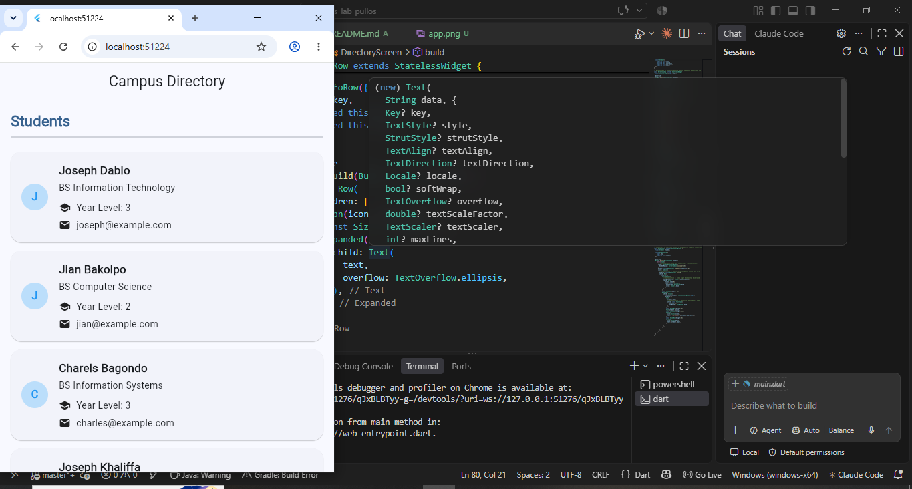

# Student Directory

**Name:** Ashley Joyd Pullos

**Activity:** Laboratory Activity 2 – Building a Student Directory with Stateless Widget

## Description

This Flutter application displays a directory of students using Stateless Widgets. Each student card shows the student's name, course, year level, and email address.

## Features

- Displays a list of sample students.
- Uses custom Stateless Widgets such as `StudentCard`, `SectionHeader`, and `InfoRow`.
- Uses a consistent Material Design theme.
- Organizes student information in a clean and readable layout.

## Technologies Used

- Flutter
- Dart
- Material Design

## Screenshot

